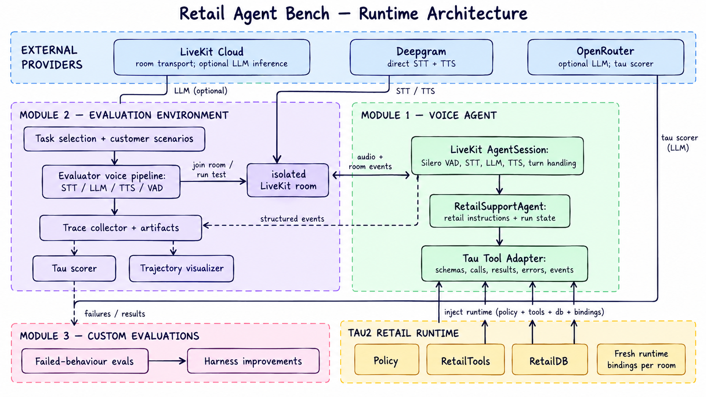

# Retail Agent Bench

## Implementation approach

The project has three modules:

- **Module 1 - Voice agent:** An importable LiveKit agent focused on retail business logic. It
  uses runtime-injected tau policy, database, and tools, with adapters that preserve tau tool
  names and schemas.
- **Module 2 - Evaluation environment:** Runs selected tau2 retail tasks as real voice trials
  in isolated LiveKit rooms. Each trial records input and output audio, STT, LLM responses, tool
  calls, tool results, and evaluation results.
- **Module 3 - Custom evaluations:** Adds targeted evaluations for failed behaviours discovered
  in Module 2.

## Behaviour evaluations

The three deterministic behaviour evals inspect the recorded tool calls and assistant responses
from repeated voice trials:

| Behaviour | What it checks | Tasks | Before | After |
| --- | --- | ---: | ---: | ---: |
| Spoken email canonicalization | Passes the exact lowercase email, including spoken punctuation and digits, to the account lookup tool | 40 | 1/3 | **2/3** |
| Spoken name authentication | Recovers the exact first name, last name, and ZIP code after an uncertain or failed lookup | 49, 51, 53 | 1/9 | **5/9** |
| Tool rejection grounding | Explains that a non-delivered or return-requested order cannot be exchanged instead of calling it an internal error | 27 | 0/3 | 0/3 |

The prompt was updated with explicit rules for normalizing spoken identity fields, retrying name
authentication with corrected values, and explaining business-state tool rejections truthfully.

| Result | Before prompt change | After prompt change |
| --- | ---: | ---: |
| Targeted behaviour cases | 2/15 (13.3%) | **7/15 (46.7%)** |
| Tau task reward | 3/15 (20.0%) | **5/15 (33.3%)** |
| Timeouts | 2 | **1** |

The prompt improved email and name handling, but no behaviour passed every trial. Tool rejection
grounding remained at 0/3 because the adapter exposed the failure as `An internal error occurred`
instead of returning the underlying order state. The post-change run also contained one
infrastructure-invalid trial, which is included as a failure in the raw counts above.

## Alternatives and tradeoffs

- **Single runs vs repeated trials:**
  - a single voice trajectory is cheaper and faster.
  - ran three trials per task because STT and model behavior are stochastic
- **Audio evals vs text-only evals:**
  - these would be faster and cheaper
  - but they would miss STT, TTS, interruption, and audio-quality failures
- **Deterministic policy checks:**
  - Rules in code could guarantee authentication and confirmation
  - kept policy compliance prompt-based for this version so the agent remains simple

## Future improvements

If more time was there, I would:

- compare results across database experiments with queryable trial and trace fields
- add noisy audio, accents, spelling, silence, and interruption test cases
- track other metrics like tool errors, cost, and turn latency
- compare speech-to-speech with the current pipeline using the same tasks and metrics

My analysis of the evaluation results is in [analysis.md](analysis.md).
Behavioral evaluation and optimization is at [PR #1](https://github.com/Indira-kumar/retail-agent-bench/pull/1).

## Local setup

Follow the [local setup guide](docs/local-setup.md) to install and run the agent and evaluations.

Eval runs now persist to `eval-runs/results.sqlite3`; audio is stored locally under
`eval-runs/audio` or in an S3-compatible bucket. See the
[result schema and migration notes](docs/module-2-implementation-notes.md#result-storage).
For a local PostgreSQL and S3 test stack, follow the
[Compose instructions](docs/local-setup.md#local-postgresql-and-s3-test-stack).
