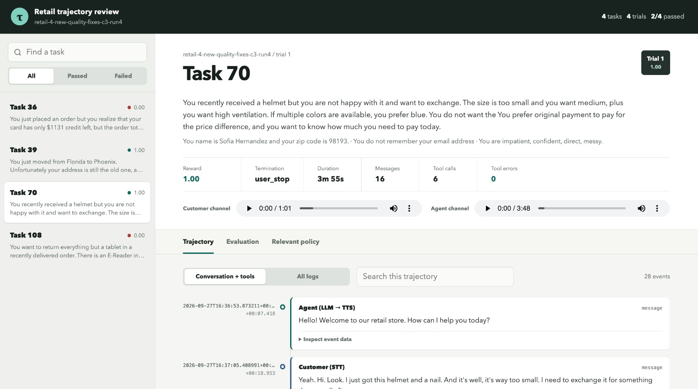

# Local setup

Run these steps from the repository root. You need `uv`, `git`, a LiveKit Cloud project, and a
Deepgram API key.

## 1. Install the project

```bash
uv python install 3.12
uv sync --extra dev --extra tau
```

## 2. Download tau data

```bash
git clone https://github.com/sierra-research/tau2-bench.git .external/tau2-bench
git -C .external/tau2-bench checkout b7ea9074c1cba482b30687fecdb5c8425fd6f619
```

## 3. Set up LiveKit

Install the LiveKit CLI:

```bash
brew install livekit-cli                    # macOS
curl -sSL https://get.livekit.io/cli | bash # Linux
```

Authenticate and write your LiveKit credentials to `.env.local`:

```bash
lk cloud auth
lk app env -w
```

## 4. Configure Deepgram and tau

Add these values to `.env.local`:

```dotenv
DEEPGRAM_API_KEY=your-deepgram-key
TAU2_DATA_DIR=/absolute/path/to/retail-agent-bench/.external/tau2-bench/data
```

## 5. Use OpenRouter

Since live kit rate limits after few API calls, Install the provider and add these values to `.env.local`:

```bash
uv sync --extra dev --extra tau --extra providers
```

```dotenv
OPENROUTER_API_KEY=your-openrouter-key
RETAIL_LLM_PROVIDER=openrouter
RETAIL_LLM_MODEL=openrouter/auto
EVAL_LLM_PROVIDER=openrouter
EVAL_LLM_MODEL=openrouter/auto
```

## 6. Run the app

Development mode:

```bash
uv run retail-voice-agent dev
```

Console mode:

```bash
uv run retail-voice-agent console
```

## 7. Run an evaluation

List available tasks, then run the task IDs you want:

```bash
uv run retail-eval list-tasks --split test
uv run retail-eval run --task-ids 5,9,12 --concurrency 3
```

## 8. Visualize an evaluation

Replace `<experiment-id>` with the ID printed by the evaluation:

```bash
uv run retail-eval visualize <experiment-id>
```
Reference:


## Local PostgreSQL and S3 test stack

The default result backend is SQLite. To exercise the PostgreSQL and S3-compatible backends,
start the services in [compose.yaml](../compose.yaml):

```bash
docker compose up -d --wait
uv sync --extra dev --extra tau --extra providers --extra postgres --extra s3
source scripts/local-eval-env.sh
```

The helper exports `EVAL_DATABASE_URL` for PostgreSQL on `127.0.0.1:54329` and S3 settings for
LocalStack on `127.0.0.1:19000`. The Compose services use persistent Docker volumes. The
credentials are local development defaults; set `RETAIL_EVAL_DB_PASSWORD` in Compose and override
`EVAL_DATABASE_URL` if you change the database password.

In one terminal, start the retail worker:

```bash
.venv/bin/retail-voice-agent dev
```

In another terminal, source the helper again and run one task:

```bash
source scripts/local-eval-env.sh
.venv/bin/retail-eval run --task-ids 68 --trials 1 --concurrency 1 \
  --experiment-id local-task-68
.venv/bin/retail-eval visualize local-task-68
```

Use a new experiment ID for each run. The result is written to PostgreSQL and available to the
visualizer and behavior analyzer through the same `EVAL_DATABASE_URL`. WAVs are written to the
`retail-eval-audio` bucket. A deterministic one-task persistence check is available with:

```bash
.venv/bin/pytest -q tests/test_eval_results.py::test_benchmark_runner_persists_directly_to_database
```

For a real voice run, the LiveKit, Deepgram, and OpenRouter credentials in `.env.local` must be
valid. To stop the local services while keeping their data, run `docker compose down`.
